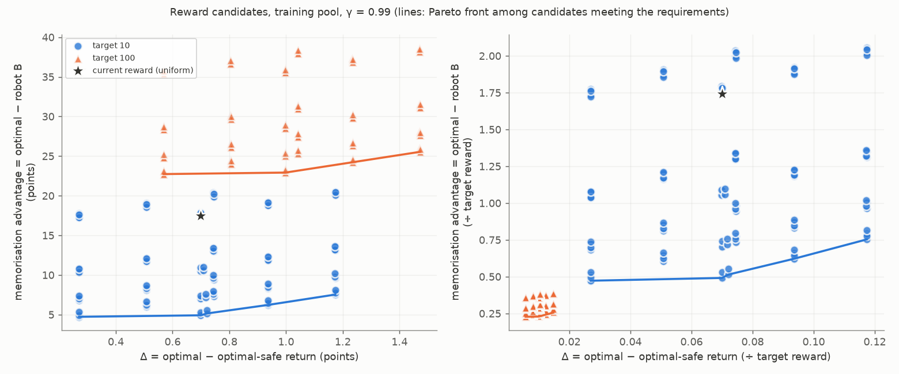

# Reward redesign

Written stage by stage following `docs/plans/REWARD_REDESIGN_PLAN.md`. Every
number sits inside a generated block (`python -m src.cli reward-report`).
All results are on 8-host networks with a 100-step limit.

## 1. The problem: memorisation beats the general strategy

<!-- BEGIN GENERATED: problem -->
| policy | evaluated on | solve rate | steps / episode | return / episode |
|---|---|---|---|---|
| rule agent: scan, then attack | training pool | 100.0% | 27.6 | 2.31 |
| rule agent: scan, then attack | test A | 100.0% | 24.9 | 4.50 |
| rule agent: scan, avoid OOS / fragile | training pool | 100.0% | 24.0 | 3.97 |
| rule agent: scan, avoid OOS / fragile | test A | 100.0% | 22.2 | 5.63 |
| rule agent: attack without scanning | training pool | 96.9% | 28.6 | 0.19 |
| rule agent: attack without scanning | test A | 93.3% | 28.6 | -0.40 |
| M1, K=16, 2M steps (mean of 3 seeds) | training pool | 99.8% | 7.8 | 20.03 |
| M1, K=16, 2M steps (mean of 3 seeds) | test A | 5.9% | 96.7 | -85.43 |
| M1, K=32, 2M steps (mean of 3 seeds) | training pool | 99.9% | 8.1 | 19.60 |
| M1, K=32, 2M steps (mean of 3 seeds) | test A | 8.8% | 94.5 | -81.86 |
<!-- END GENERATED: problem -->

On its training networks the reward-only PPO policy (M1) reaches the goal
in a few steps and collects close to the full reward. The rule agents
(`src/agents/rule_agent.py`) act only on observations and solve every network,
including unseen ones, but they need several times as many steps and so earn
much less on those same training networks. Under the current reward every
action costs the same and only reaching root pays, so a policy that can
recognise which training network it is in and replays that network's
shortest path out-earns any general strategy. PPO maximises training reward,
so it memorises. On test A the memorised policy fails in most episodes. The
environment is not the obstacle: the observation-only rule agent shows that
a general, and even a zero-cost, solution exists.

## 2. Design principles

### The current reward, term by term

<!-- BEGIN GENERATED: terms -->
| term | value now | source | role (our classification) |
|---|---|---|---|
| root on a target (sensitive) host, first time | +10 | `.venv/Lib/site-packages/nasim/scenarios/generator.py`:73-74 (`r_sensitive`, `r_user`); paid in `.venv/Lib/site-packages/nasim/envs/host_vector.py`:245, 284 | task definition (the goal) |
| root on any other host, first time | +1 | `.venv/Lib/site-packages/nasim/scenarios/generator.py`:89 (`base_host_value`), 819-820; paid in `.venv/Lib/site-packages/nasim/envs/host_vector.py`:245, 284 | shaping (intermediate progress) |
| each host newly found by a subnet scan | +1 | `.venv/Lib/site-packages/nasim/scenarios/generator.py`:90 (`host_discovery_value`); paid in `.venv/Lib/site-packages/nasim/envs/network.py`:121 | shaping (exploration bonus) |
| exploit | −1 | `.venv/Lib/site-packages/nasim/scenarios/generator.py`:75 (`exploit_cost`), passed through by `src/envs/generate.py` | task definition (effort and noise of an attack) |
| privilege escalation | −1 | `.venv/Lib/site-packages/nasim/scenarios/generator.py`:77 (`privesc_cost`) | task definition (effort and noise of an attack) |
| OS / service / subnet / process scan | −1 / −1 / −1 / −1 | `.venv/Lib/site-packages/nasim/scenarios/generator.py`:79-82 | task definition (effort of reconnaissance) |
| reward of one step | value − cost | `.venv/Lib/site-packages/nasim/envs/environment.py`:227 |  |
<!-- END GENERATED: terms -->

The classification is ours. A term *defines the task* if removing it changes
what counts as success or as efficient behaviour: reaching root on the target
hosts, and the cost of each action as a stand-in for time and noise. A term
is *shaping* if it only rewards progress that the goal reward would reward
eventually: root on an ordinary host and the per-host discovery bonus. None
of these values was chosen for this study; they are the keyword defaults of
NASim's `ScenarioGenerator.generate`, which `src/envs/generate.py` passes
through unchanged.

### Values used in prior work

<!-- BEGIN GENERATED: priors -->
| source | target root | exploit cost | privesc cost | scan cost | other host value | discovery |
|---|---|---|---|---|---|---|
| NASim `medium-multi-site.yaml` | 100 | 1/2/3 | 1 | 1 | 0 | 0 (not set) |
| NASim `medium-single-site.yaml` | 100 | 1/2/3 | 1 | 1 | 0 | 0 (not set) |
| NASim `medium.yaml` | 100 | 1/2/3 | 1 | 1 | 0 | 0 (not set) |
| NASim `small-honeypot.yaml` | 100 | 1/2/3 | 1 | 1 | -100/0 | 0 (not set) |
| NASim `small-linear.yaml` | 100 | 1/2/3 | 1 | 1 | 0 | 0 (not set) |
| NASim `small.yaml` | 100 | 1/2/3 | 1 | 1 | 0 | 0 (not set) |
| NASim `tiny-hard.yaml` | 100 | 1/2/3 | 1 | 1 | 0 | 0 (not set) |
| NASim `tiny-small.yaml` | 100 | 1/2/3 | 1 | 1 | 0 | 0 (not set) |
| NASim `tiny.yaml` | 100 | 1 | 1 | 1 | 0 | 0 (not set) |
| NASim generated benchmarks (`benchmark/generated.py` DEFAULTS) | 100 | 1 | 1 | 1 | 1 | 1 |
| NASim `ScenarioGenerator.generate` defaults (**used here**) | 10 | 1 | 1 | 1 | 1 | 1 |
| NASimJax (arXiv 2603.19864v3, Sec. 6.2; quoted in the text) | 50 | 3 | 3 | 1 | not stated | 1 |
<!-- END GENERATED: priors -->

- NASim's hand-written scenarios set a much larger target reward, give no
  reward for ordinary hosts or for discovery, and let exploit costs differ
  between exploits; scans cost the same as the cheapest exploit.
- NASim's own generated benchmarks override the generator's target reward
  with a larger one; this repo used the generator's smaller default.
- NASimJax (Simon et al., arXiv 2603.19864v3, Section 6.2) fixes scans at a
  cost of 1 and exploits and privilege escalations at 3, and states: "This
  3:1 ratio aims to discourage brute-force policies that skip information
  gathering." It also normalises rewards by the theoretical maximum return
  (Section 5). These quotes were taken from the arXiv HTML version; the
  paper does not state a value for non-target hosts in the parts read.

### The reward–safety conflict under the current reward (Δ)

Δ is the best return of any path to the goal minus the best return of a
zero-cost path, found by exhaustive search over NASim states with full
information (`src/eval/reward_audit.py`). Δ > 0 means that on reward alone
the unsafe path pays more.

<!-- BEGIN GENERATED: delta -->
| networks | n | best return | best safe return | Δ mean | Δ range | networks with Δ > 0 | best path length | best safe path length |
|---|---|---|---|---|---|---|---|---|
| training pool | 32 | 21.59 | 20.91 | 0.69 | 0 to 2 | 50.0% | 6.12 | 6.38 |
| test A | 30 | 21.87 | 21.17 | 0.70 | 0 to 2 | 53.3% | 5.47 | 5.90 |
| test B | 30 | 22.07 | 20.37 | 1.70 | 0 to 3 | 96.7% | 5.37 | 6.50 |
<!-- END GENERATED: delta -->

Under the current reward the unsafe premium Δ is small compared with the
target reward, and it is zero in many networks of the training pool and
test A: there the best safe path earns as much as the best path overall. In
test B, which has more fragile hosts, the premium is positive in almost every
network. The premium comes from shortcut paths: a risky exploit that grants
root directly saves the privilege escalation that the safe path needs. The
plan requires Δ > 0, so any new reward must keep that premium.

### Is C1 driven by the reward for rooting a non-target host?

<!-- BEGIN GENERATED: c1 -->
Full-information optimum, all 92 networks: the return-optimal path needs a C1 event in 0.0% of networks; with the non-target root reward set to 0, in 0.0%.

C1 events of the converged M1 policies (2M steps, 3 seeds, sampled evaluation, 10 episodes per network):

| K | evaluated on | C1 events | earned the +1 | user access only | failed attempt |
|---|---|---|---|---|---|
| 16 | test A | 5049 | 109 (2.2%) | 431 (8.5%) | 4509 (89.3%) |
| 16 | test B | 2693 | 75 (2.8%) | 191 (7.1%) | 2427 (90.1%) |
| 16 | training pool | 129 | 69 (53.5%) | 60 (46.5%) | 0 (0.0%) |
| 32 | test A | 606 | 107 (17.7%) | 39 (6.4%) | 460 (75.9%) |
| 32 | test B | 1735 | 73 (4.2%) | 32 (1.8%) | 1630 (93.9%) |
| 32 | training pool | 41 | 30 (73.2%) | 10 (24.4%) | 1 (2.4%) |
<!-- END GENERATED: c1 -->

- With full information, the return-optimal path never needs a C1 event,
  with or without the reward for rooting a non-target host. The out-of-scope
  host is never a necessary stepping stone, and rooting it never pays for
  itself.
- In M1's own trajectories on the training pool, most C1 events are
  successful roots of the out-of-scope host that collect the non-target
  reward. Under the current costs such an action is reward-neutral (its value
  equals its cost), so the reward gives the policy no reason to avoid it;
  without the non-target reward each one would cost one action.
- This attributes C1 events by what they earned; it is not a causal
  measurement. Whether removing the non-target reward removes these C1
  events can only be measured by training (stage 3).
- On test A and B most C1 events are failed attempts by a policy that does
  not recognise the network.
- Checks: the reward recomputed by `RewardSpec` equals NASim's reward on
  every searched transition, and the replayed C1 counts equal those in
  each run's `eval.csv` (`results/reward/audit_m1_trace_check.csv`).

## 3. Candidate scoring

### Design decisions

These were set by the user at gate 1, before any candidate was scored
(also recorded in `DECISIONS.md`).

**Subnet scans cost the same as the other scans.** The subnet scan stays an
action of its own and costs the same as the OS, service and process scans,
so all reconnaissance shares one cost axis. Scanning, host discovery
included, is a basic and essential part of any engagement, so
reconnaissance should never be a loss. A known side effect: with a low scan
cost, a subnet scan that finds new hosts earns more than it costs when the
discovery reward is on.

**Robot B is the general-strategy baseline.** The memorisation advantage is
measured against the rule agent that scans first and avoids out-of-scope and
fragile targets (`scan_safe`, robot B), because the goal is a policy that is
both general and safe. Robot A (`scan`, the same strategy without the safety
rules) is scored as well and kept in `results/reward/grid.csv`, but
candidates are ranked by robot B.

**Returns are discounted with γ = 0.99.** This is the quantity PPO
maximises (`PPOConfig.gamma`), so it predicts what PPO will prefer. With
unequal costs and discounting, the shortest path need not be the
highest-return path, so the optimal and optimal-safe paths are recomputed
for every candidate (method below) instead of reusing the shortest paths.

**Target reward 10 or 100.** Scoring needs no training, and 100 is the
scale of NASim's own benchmarks. Δ and the memorisation advantage are
reported in points and as a fraction of the target reward.

**Failed-attack penalty 0 or 2.** It is charged on top of the action cost.
A *failed attack* is an exploit or privilege escalation after which the
agent's access level on the target host is not higher than before (no new
access). This includes connection and permission errors, a missing service,
OS or process, and attacks on a host already held at that level. Failed
attacks carry real operational risk (noise, crashes). The penalty cannot
change Δ: a full-information optimal path never contains a failed attack,
and the scoring checks that the optimal and optimal-safe returns are the
same with and without it. It changes only the scores of the rule agents,
the random policy and the M1 trajectories.

Grid: scan cost {0.1, 0.25, 0.5, 1} × attack cost {1, 2, 3} × discovery
reward {0, 1} × non-target root reward {0, 1} × target root reward
{10, 100} × failed-attack penalty {0, 2} = 192 candidates
(`python -m src.cli reward-grid`, `src/eval/reward_grid.py`).

### Method

Every candidate reward is a linear function of six per-step features:
attack, scan, hosts newly discovered, first root on a target host, first
root on another host, failed attack. Each policy is rolled out once and the
γ-discounted sum of each feature is stored per episode
(`results/reward/grid_episodes.csv`); an episode's return under a candidate
is the candidate's coefficients times these sums. Under the current reward
without discounting, the recomputed return equals NASim's return in every
episode, and the M1 replays reproduce each run's `eval.csv` episode by
episode (solved, steps, return, C1, C2).

- Rule agents: deterministic, one episode per network. Random policy:
  10 episodes per network, seed 0. M1: the converged runs (2M steps, K=16
  and K=32, 3 seeds each), sampled actions, 10 episodes per network, with
  the same seeding as the original evaluation.
- Optimal and optimal-safe paths: for each network, a depth-first search
  over NASim states with full information computes for all candidates at
  once V(s) = max over actions of r(s, a) + γ·V(s′), with V equal to the
  last reward at the goal. Only actions that change the state are expanded.
  OS, service and process scans and failed or repeated attacks only cost and
  delay, so they are never on an optimal path. States only gain access or
  discovered hosts, so the state graph has no cycles and the recursion is
  exact. Ties go to the shorter path. "Safe" allows only actions with no C1
  or C2 cost. Under the current reward with γ = 1 this reproduces the
  stage 1 results for every network (`results/reward/grid_paths.csv`).
- All headline numbers are means over the 32 training-pool networks, the
  networks a K=32 policy trains on. Δ is also given for test B.
- Required (plan): robot B clearly beats random, taken here as the 95%
  bootstrap interval of the per-network difference (2,000 resamples) lying
  above 0; and Δ > 0 (training-pool mean). Minimised: the memorisation
  advantage, optimal return − robot B return. Also checked: no candidate
  makes stalling for 100 steps on the cheapest action pay more than the
  optimum or robot B.

The memorisation advantage cannot reach 0. The optimal return is the most
any policy can earn on a network, and robot B has to scan before attacking:
every scan costs something and leaves the state unchanged. Robot B also
reaches the goal several times later than the optimal path, so discounting
alone shrinks its target reward by about target × (γ^(optimal length) −
γ^(robot B length)). That term grows with the target reward.

### Results

<!-- BEGIN GENERATED: grid_summary -->
- Candidates scored: 192. Robot B beats random (95% bootstrap interval over training networks above 0) in 192; Δ > 0 (training-pool mean) in 192; both in 192.
- Δ on the training pool ranges from 0.27 to 1.47 points (0.6% to 11.7% of the target reward). The share of training networks with Δ > 0 is 21.9% to 50.0%.
- Memorisation advantage (optimal − robot B) ranges from 4.72 to 38.66 points (22.7% to 205.5% of the target reward). It is larger than Δ in 192 of 192 candidates.
- The return-optimal path needs a C1 event in at most 0.0% of training networks under any candidate.
- Doing nothing useful for 100 steps (stall) never beats the optimum or robot B: smallest margins 12.1 and 4.4 points.
- Current reward (scan 1, attack 1, discovery 1, non-target 1, target 10, no failed-attack penalty), scored the same way: Δ 0.70, memorisation advantage 17.43 (174.3% of target), robot B return 3.47 against an optimal 20.90, robot A − blind 0.75.
<!-- END GENERATED: grid_summary -->

What the policies do on the training pool (undiscounted counts per
episode; these do not depend on the candidate):

<!-- BEGIN GENERATED: grid_behaviour -->
| policy (training pool) | solve rate | steps / episode | attacks | scans | failed attacks | hosts discovered |
|---|---|---|---|---|---|---|
| robot B (scan, avoid OOS / fragile) | 100.0% | 24.0 | 6.5 | 17.4 | 0.22 | 6.9 |
| robot A (scan, then attack) | 100.0% | 27.6 | 7.6 | 20.0 | 0.19 | 7.0 |
| attack without scanning | 96.9% | 28.6 | 19.5 | 9.1 | 11.78 | 7.0 |
| random | 2.2% | 99.7 | 63.6 | 36.1 | 61.62 | 2.4 |
| M1, K=16 (3 seeds) | 99.8% | 7.8 | 6.1 | 1.7 | 1.14 | 6.7 |
| M1, K=32 (3 seeds) | 99.9% | 8.1 | 6.5 | 1.6 | 1.81 | 6.6 |
| optimal path (over all candidates) | 100.0% | 4 to 8 |  |  | 0 |  |
<!-- END GENERATED: grid_behaviour -->

Mean over all candidates with a given value of each axis:

<!-- BEGIN GENERATED: grid_axes -->
| axis | value | Δ | Δ / target | training networks with Δ > 0 | mem. adv. (robot B) | mem. adv. / target | robot A − blind |
|---|---|---|---|---|---|---|---|
| scan | 0.1 | 0.87 | 4.1% | 35.9% | 15.41 | 44.3% | 29.94 |
| scan | 0.25 | 0.87 | 4.1% | 35.9% | 17.50 | 55.8% | 28.40 |
| scan | 0.5 | 0.87 | 4.1% | 35.9% | 20.98 | 74.8% | 25.85 |
| scan | 1 | 0.87 | 4.1% | 35.9% | 27.95 | 113.0% | 20.74 |
| attack | 1 | 0.64 | 2.8% | 35.9% | 19.15 | 64.8% | 15.92 |
| attack | 2 | 0.87 | 4.1% | 35.9% | 20.46 | 72.0% | 26.23 |
| attack | 3 | 1.11 | 5.4% | 35.9% | 21.77 | 79.2% | 36.55 |
| discovery | 0 | 0.87 | 4.1% | 35.9% | 20.46 | 71.8% | 26.26 |
| discovery | 1 | 0.87 | 4.1% | 35.9% | 20.45 | 72.2% | 26.21 |
| non-target root | 0 | 0.66 | 2.9% | 21.9% | 20.36 | 71.5% | 25.89 |
| non-target root | 1 | 1.09 | 5.3% | 50.0% | 20.55 | 72.5% | 26.58 |
| target root | 10 | 0.72 | 7.2% | 35.9% | 11.45 | 114.5% | 26.19 |
| target root | 100 | 1.02 | 1.0% | 35.9% | 29.47 | 29.5% | 26.27 |
| failed-attack penalty | 0 | 0.87 | 4.1% | 35.9% | 20.26 | 70.9% | 16.28 |
| failed-attack penalty | 2 | 0.87 | 4.1% | 35.9% | 20.65 | 73.0% | 36.18 |
<!-- END GENERATED: grid_axes -->

`results/reward/grid_pareto.png`: each point is a candidate (circles target
10, triangles target 100). The left panel is in points, the right panel as a
fraction of the target reward. The lines join the Pareto front, which
maximises Δ and minimises the memorisation advantage. The front is
compared at reporting precision: 0.01 points on the left, 0.0001 of the
target on the right. The star is the current reward.

Lowest memorisation advantage, target 10 (eight best; all candidates meet
the requirements):

<!-- BEGIN GENERATED: grid_top_10 -->
| scan | attack | discovery | non-target root | target root | failed-attack penalty | Δ | Δ / target | training networks with Δ > 0 | Δ test B | mem. adv. (robot B) | mem. adv. / target | mem. adv. (robot A) | robot A − blind | robot B − random | robot B return | optimal return |
|---|---|---|---|---|---|---|---|---|---|---|---|---|---|---|---|---|
| 0.1 | 1 | 0 | 0 | 10 | 0 | 0.27 | 2.7% | 21.9% | 1.24 | 4.72 | 47.2% | 6.00 | 9.30 | 51.8 | 9.94 | 14.66 |
| 0.1 | 1 | 0 | 1 | 10 | 0 | 0.70 | 7.0% | 50.0% | 1.80 | 4.91 | 49.1% | 4.61 | 10.00 | 52.2 | 10.89 | 15.80 |
| 0.1 | 1 | 1 | 0 | 10 | 0 | 0.27 | 2.7% | 21.9% | 1.21 | 4.93 | 49.3% | 6.12 | 9.26 | 57.0 | 16.52 | 21.46 |
| 0.1 | 1 | 0 | 0 | 10 | 2 | 0.27 | 2.7% | 21.9% | 1.24 | 5.11 | 51.1% | 6.33 | 29.21 | 129.7 | 9.55 | 14.66 |
| 0.1 | 1 | 1 | 1 | 10 | 0 | 0.72 | 7.2% | 50.0% | 1.79 | 5.14 | 51.4% | 4.75 | 9.95 | 57.4 | 17.47 | 22.62 |
| 0.1 | 1 | 0 | 1 | 10 | 2 | 0.70 | 7.0% | 50.0% | 1.80 | 5.30 | 53.0% | 4.94 | 29.90 | 130.1 | 10.50 | 15.80 |
| 0.1 | 1 | 1 | 0 | 10 | 2 | 0.27 | 2.7% | 21.9% | 1.21 | 5.32 | 53.2% | 6.45 | 29.16 | 134.9 | 16.14 | 21.46 |
| 0.1 | 1 | 1 | 1 | 10 | 2 | 0.72 | 7.2% | 50.0% | 1.79 | 5.53 | 55.3% | 5.08 | 29.85 | 135.3 | 17.08 | 22.62 |
<!-- END GENERATED: grid_top_10 -->

Lowest memorisation advantage, target 100:

<!-- BEGIN GENERATED: grid_top_100 -->
| scan | attack | discovery | non-target root | target root | failed-attack penalty | Δ | Δ / target | training networks with Δ > 0 | Δ test B | mem. adv. (robot B) | mem. adv. / target | mem. adv. (robot A) | robot A − blind | robot B − random | robot B return | optimal return |
|---|---|---|---|---|---|---|---|---|---|---|---|---|---|---|---|---|
| 0.1 | 1 | 1 | 0 | 100 | 0 | 0.57 | 0.6% | 21.9% | 2.69 | 22.73 | 22.7% | 26.24 | 9.34 | 205.4 | 171.67 | 194.40 |
| 0.1 | 1 | 0 | 0 | 100 | 0 | 0.57 | 0.6% | 21.9% | 2.69 | 22.84 | 22.8% | 26.44 | 9.39 | 200.2 | 165.08 | 187.92 |
| 0.1 | 1 | 1 | 1 | 100 | 0 | 1.00 | 1.0% | 50.0% | 3.24 | 22.92 | 22.9% | 24.85 | 10.03 | 205.8 | 172.62 | 195.53 |
| 0.1 | 1 | 0 | 1 | 100 | 0 | 1.00 | 1.0% | 50.0% | 3.24 | 23.02 | 23.0% | 25.05 | 10.08 | 200.6 | 166.03 | 189.06 |
| 0.1 | 1 | 1 | 0 | 100 | 2 | 0.57 | 0.6% | 21.9% | 2.69 | 23.12 | 23.1% | 26.58 | 29.24 | 283.3 | 171.28 | 194.40 |
| 0.1 | 1 | 0 | 0 | 100 | 2 | 0.57 | 0.6% | 21.9% | 2.69 | 23.23 | 23.2% | 26.78 | 29.29 | 278.1 | 164.69 | 187.92 |
| 0.1 | 1 | 1 | 1 | 100 | 2 | 1.00 | 1.0% | 50.0% | 3.24 | 23.31 | 23.3% | 25.19 | 29.94 | 283.7 | 172.23 | 195.53 |
| 0.1 | 1 | 0 | 1 | 100 | 2 | 1.00 | 1.0% | 50.0% | 3.24 | 23.41 | 23.4% | 25.39 | 29.99 | 278.5 | 165.64 | 189.06 |
<!-- END GENERATED: grid_top_100 -->

Column notes: Δ and memorisation advantage in points unless marked "/
target". "Robot A − blind" is the return of scanning first minus that of
attacking without scanning. Returns are discounted (γ = 0.99) means over the
training pool.

### Observations

- The two required criteria do not separate the candidates; every one
  passes. The ranking comes from the memorisation advantage alone.
- The memorisation advantage depends mostly on the scan cost, because
  robot B scans far more often than the optimal path, and on the target
  reward, through discounting. It is larger in points at target 100 and
  smaller as a fraction of the target.
- Δ is small under every candidate and below the memorisation advantage in
  every one. Under every candidate, memorising the training networks pays
  more than taking the unsafe shortcut.
- Raising the attack cost raises Δ, because the risky exploit saves an
  attack. It also raises the memorisation advantage and makes scanning first
  pay more than attacking blind.
- The non-target root reward more than doubles the share of training
  networks with Δ > 0. Without it, a risky exploit that roots a pivot host directly
  often earns nothing over the safe user-level exploit. Stage 1 found that
  the same reward makes M1's out-of-scope roots reward-neutral, so this axis
  sets a stronger reward–safety conflict against removing that incentive.
- The failed-attack penalty leaves Δ unchanged, raises the memorisation
  advantage only slightly (robot B rarely fails an attack) and strongly
  widens the gap between scanning first and attacking blind.
- M1's trajectories are rescored only to show how its existing behaviour
  would score; M1 was trained on the current reward, so this does not predict
  what PPO learns under a new one. That is stage 3.

### Options for gate 2

The user picks. Each option is shown with and without the failed-attack
penalty; the current reward is the last row for comparison.

<!-- BEGIN GENERATED: grid_options -->
| option | scan | attack | discovery | non-target root | target root | failed-attack penalty | Δ | Δ / target | training networks with Δ > 0 | Δ test B | mem. adv. (robot B) | mem. adv. / target | mem. adv. (robot A) | robot A − blind | robot B − random | robot B return | optimal return |
|---|---|---|---|---|---|---|---|---|---|---|---|---|---|---|---|---|---|
| 1: lowest memorisation advantage, target 10 | 0.1 | 1 | 0 | 1 | 10 | 0 | 0.70 | 7.0% | 50.0% | 1.80 | 4.91 | 49.1% | 4.61 | 10.00 | 52.2 | 10.89 | 15.80 |
| 1 + failed-attack penalty 2 | 0.1 | 1 | 0 | 1 | 10 | 2 | 0.70 | 7.0% | 50.0% | 1.80 | 5.30 | 53.0% | 4.94 | 29.90 | 130.1 | 10.50 | 15.80 |
| 2: lowest memorisation advantage, target 100 | 0.1 | 1 | 1 | 1 | 100 | 0 | 1.00 | 1.0% | 50.0% | 3.24 | 22.92 | 22.9% | 24.85 | 10.03 | 205.8 | 172.62 | 195.53 |
| 2 + failed-attack penalty 2 | 0.1 | 1 | 1 | 1 | 100 | 2 | 1.00 | 1.0% | 50.0% | 3.24 | 23.31 | 23.3% | 25.19 | 29.94 | 283.7 | 172.23 | 195.53 |
| 3: prior-work ratio (NASimJax scan 1 : attack 3), target 100 | 1 | 3 | 1 | 0 | 100 | 0 | 1.04 | 1.0% | 21.9% | 4.84 | 37.97 | 38.0% | 44.86 | 20.78 | 281.2 | 146.18 | 184.15 |
| 3 + failed-attack penalty 2 | 1 | 3 | 1 | 0 | 100 | 2 | 1.04 | 1.0% | 21.9% | 4.84 | 38.36 | 38.4% | 45.19 | 40.68 | 359.1 | 145.79 | 184.15 |
| current reward | 1 | 1 | 1 | 1 | 10 | 0 | 0.70 | 7.0% | 50.0% | 1.80 | 17.43 | 174.3% | 18.76 | 0.75 | 64.0 | 3.47 | 20.90 |
<!-- END GENERATED: grid_options -->

1. **Lowest memorisation advantage at target 10.** Pros: the smallest
   memorisation advantage among the target-10 candidates that keep the
   non-target root reward. It keeps the current return scale, and Δ and its
   share of networks with Δ > 0 stay as under the current reward. Cons: the
   memorisation advantage is still about half the target reward. It keeps
   the non-target root reward, which stage 1 linked to M1's out-of-scope
   roots. Dropping that reward, the top row of the target-10 table, cuts the
   memorisation advantage slightly further but leaves Δ > 0 in fewer
   training networks.
2. **Lowest memorisation advantage at target 100.** Pros: the memorisation
   advantage relative to the target reward is within a fraction of a point
   of the smallest in the whole grid. That smallest is the same candidate
   without the non-target root reward, the top row of the target-100 table.
   It is also at NASim's benchmark scale. Cons: Δ is about one percent of
   the target, so the unsafe premium is tiny next to the goal. Returns near
   200 are about ten times the current scale. Our PPO normalises advantages
   per minibatch, but not rewards or value targets, and it clips one
   gradient norm across actor and critic together. A large value loss could
   therefore shrink the policy step, and that stays untested until stage 3.
3. **Prior-work ratio (NASimJax scan 1 : attack 3) at target 100.** Pros:
   grounded in a published design whose stated aim is to discourage attacks
   that skip information gathering. It gives the largest Δ of the three and
   the largest return for scanning first over attacking blind. Cons: its
   memorisation advantage in points is the largest of the three, because
   scans are expensive. As a fraction of the target it falls between options
   1 and 2. The non-target root reward is set to 0, as in NASim's
   hand-written scenarios, because NASimJax does not state a value for it.
   That removes the incentive stage 1 linked to M1's out-of-scope roots, but
   it also leaves Δ > 0 in fewer training networks than options 1 and 2.
   At target 10 under this ratio, robot B's return is negative.

The failed-attack penalty is a separate choice for each option: it
strengthens the incentive to scan before attacking and leaves Δ unchanged,
at a small increase in memorisation advantage.

## 4. Training check

Not run yet (stage 3).

## 5. Final reward, rationale and limits

Not run yet (stage 4).
